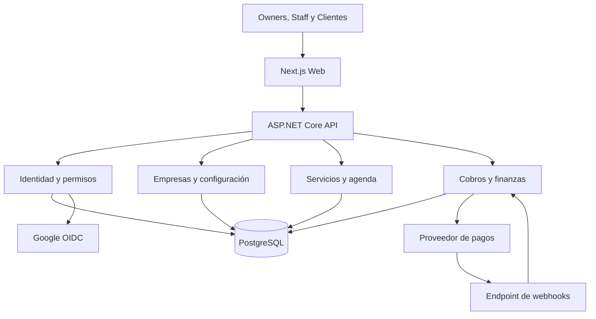

# SlotEngine — Architecture Overview

> Estado: arquitectura objetivo preliminar v0.1 · Fecha: 2026-11-22

## 1. Principios
- Empezar con **monolito modular**, no microservicios.
- Separar lógica de negocio, persistencia, API y UI.
- Aislamiento multiempresa desde el primer endpoint de datos de negocio.
- Seguridad y observabilidad por diseño.
- Automatizar pruebas y despliegues progresivamente.
- Evitar introducir componentes no justificados por una necesidad real.

## 2. Stack base (por validar al inicializar)
| Capa | Tecnología | Responsabilidad |
| --- | --- | --- |
| Web | Next.js, React, TypeScript | Panel, onboarding y portal público |
| Backend | ASP.NET Core Web API, C# | API, autorización, reglas de negocio |
| Persistencia | PostgreSQL y Entity Framework Core | Entidades, consultas y migraciones |
| Local | Docker Compose | Base de datos y servicios de apoyo |
| Repositorio | Git + GitHub | Historial, PR, issues |
| Automatización | GitHub Actions | Build, lint, tests y CI/CD |
| Identidad | Google OpenID Connect + sesiones seguras | Inicio de sesión y identidad |
| Pagos | Mercado Pago sandbox (primero) | Checkout, webhooks y conciliación |

Se verifican versiones, SDK, licencias y compatibilidad al iniciar el proyecto.

## 3. Diagrama lógico


## 4. Multi-tenancy
**Modelo inicial propuesto:** base de datos compartida y esquema compartido, con `BusinessId` en entidades de negocio y verificación de permisos por membresía.

- El tenant se resuelve a partir del negocio seleccionado/ruta **y se valida contra la sesión y membresías**.
- No confiar en un `BusinessId` enviado por el frontend sin autorización.
- Aplicar filtros de tenant y restricciones también a operaciones de escritura, agregaciones y consultas raw SQL.
- Revisar claves únicas compuestas por tenant cuando sea necesario.
- Las rutas públicas solo exponen datos permitidos por las reglas de publicación.
- Crear pruebas de aislamiento cruzado para cada endpoint relevante.
- Considerar PostgreSQL Row-Level Security como defensa adicional, sujeto a diseño de conexión y pruebas; no reemplaza validaciones de autorización.

## 5. Identidad y roles
- Google OIDC para identidad; la cuenta de plataforma tiene identificador interno independiente del email.
- `Users` almacena identidad interna; `BusinessMemberships` relaciona usuario, empresa y rol.
- `PlatformAdmin` es rol global separado de `Owner` y `Staff`, que son roles por empresa.
- Controlar sesiones, tokens, expiración, CSRF y cookies de acuerdo con el flujo elegido.
- Privilegios mínimos, trazabilidad de acciones administrativas y acceso de soporte excepcional.

## 6. Módulos lógicos iniciales
- **Identity:** usuarios, autenticación y sesiones.
- **Businesses:** registro, configuración, branding y membresías.
- **Catalog:** servicios y precios.
- **Scheduling:** disponibilidad, recursos y citas.
- **CRM:** clientes e historial.
- **Billing:** cobros, reembolsos y pasarelas.
- **Finance:** costos, gastos, reportes de contribución.
- **Platform:** administración SaaS y auditoría.

Los límites se reflejarán en namespaces/carpetas y evolucionarán según necesidades reales.

## 7. Entidades iniciales
`User`, `Business`, `BusinessMembership`, `BusinessSettings`, `Service`, `Customer`, `Appointment`, `Payment`, `Expense`, `AuditLog`.

Se agregarán `Employee`, `Resource`, `AvailabilityRule`, `PaymentProviderConnection`, `Subscription` y otras cuando las historias de usuario lo requieran. No crear tablas especulativas en la primera migración.

## 8. Pagos
Distinguir claramente:
1. **Cobro por uso de SlotEngine:** empresa → plataforma.
2. **Cobro del servicio:** cliente final → empresa.

Iniciar con registro manual de cobros; integrar después Mercado Pago en ambiente de pruebas. Para pagos reales, verificar modelo marketplace, requisitos por país y cuenta conectada. Nunca almacenar PAN/CVV.

Para toda integración:
- Mantener credenciales solo en backend y secret stores.
- Verificar autenticidad de webhooks.
- Implementar idempotencia, deduplicación y reintentos seguros.
- Consultar estado del pago al proveedor para conciliación.
- Registrar eventos y errores sin datos sensibles.

## 9. Estrategia Git y estructura propuesta
```text
slotengine/
  apps/
    web/                  # Next.js
  src/
    SlotEngine.Api/       # ASP.NET Core
    SlotEngine.Core/      # Dominio y reglas (si se justifica)
    SlotEngine.Infrastructure/  # Persistencia e integraciones
  tests/
  docs/
    adr/
  .github/workflows/
  compose.yaml
  README.md
  PRODUCT.md
  ARCHITECTURE.md
  ROADMAP.md
  CONTRIBUTING.md
```
La estructura es una guía; las carpetas y proyectos concretos se ajustarán durante Sprint 0.

## 10. Ambientes y despliegue
- `local`: desarrollo con variables y credenciales locales ignoradas por Git.
- `staging`: integración y pruebas con datos sintéticos.
- `production`: usuarios reales, secretos administrados, backups y monitoreo.

CI mínima: formato/lint, compilación, pruebas y análisis de dependencias cuando corresponda. CD: despliegues automatizados con controles apropiados por ambiente, migraciones gestionadas y rollback documentado.

## 11. Calidad y seguridad
- Validaciones en backend; el frontend solo complementa la experiencia.
- Tests unitarios, integración con DB y pruebas end-to-end de flujos críticos.
- Logs estructurados con correlation ID; sin secretos ni PII sensible.
- Manejo homogéneo de errores, health checks y métricas básicas.
- Revisiones de permisos, rate limits y controles antiabuso en endpoints públicos.
- Backups y restauración probada antes de producción.

## 12. ADR pendientes
- ADR-001: modelo inicial de tenancy.
- ADR-002: proveedor y patrón de autenticación.
- ADR-003: hosting y persistencia por ambiente.
- ADR-004: estrategia de reservas concurrentes.
- ADR-005: licencia de distribución.
